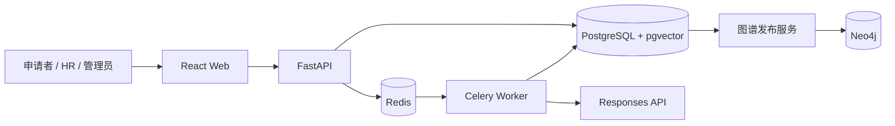

# 岗位能力图谱与智能人岗匹配系统

面向新质岗位的能力建模、简历评估与可解释人岗匹配平台。

系统以统一能力框架连接市场岗位描述、岗位要求、候选人简历和招聘项目，将“专业背景—经历证据—能力画像—岗位要求—成长路径”组织为可版本化、可审核的知识图谱。大语言模型负责受约束的信息抽取，最终匹配分数由后端确定性算法计算，结果可追溯到能力、原文证据和图谱版本。

## 功能概览

### 求职者

- 上传 PDF 或 DOCX 简历并异步解析
- 检查、修订和确认结构化能力画像
- 查看岗位推荐、匹配依据和能力缺口
- 围绕目标岗位生成可执行的成长路径

### HR

- 创建招聘项目并解析岗位描述（JD）
- 确认岗位能力要求和等级
- 批量处理候选人简历并查看排序
- 查看候选人的能力证据，而不只依赖总分

### 管理员

- 管理申请者、HR 和管理员账号
- 维护能力、别名、BARS 行为锚点和岗位目录
- 审核新兴岗位、未映射技能与图谱变更
- 发布版本化知识图谱并检查系统运行状态

### 平台能力

- 33 项能力框架：9 项硬技能与 24 项可迁移能力
- 192 个可复现的新兴岗位聚合定义
- 3D 岗位能力图谱与关系查询
- 任务进度、失败诊断、审核记录和版本追踪

## 设计原则

1. **证据优先**：能力结论尽量关联简历或 JD 原文片段。
2. **人在回路**：模型输出先进入候选态，经用户或审核人员确认后使用。
3. **确定性评分**：LLM 不直接决定匹配分数，评分逻辑可测试、可复现。
4. **版本化发布**：推荐结果绑定能力目录、图谱和算法版本。
5. **单一事实源**：PostgreSQL 保存业务事实，Neo4j 只保存正式图谱投影。

## 技术架构



| 层次 | 技术 |
| --- | --- |
| Web | React 19、TypeScript、Vite、Ant Design、Three.js、ECharts |
| API | Python 3.12、FastAPI、Pydantic、SQLAlchemy Async |
| 数据 | PostgreSQL 16、pgvector、Neo4j 5 |
| 异步任务 | Redis 7、Celery 5 |
| 迁移与测试 | Alembic、pytest、Ruff、Oxlint |
| 部署 | Docker Compose |

## 快速开始

### 1. 获取代码

需要预先安装 Git、Docker Desktop、Node.js 20+ 和 npm。

```bash
git clone https://github.com/Showiix/job-capability-graph-backend.git
cd job-capability-graph-backend
cp .env.example .env
```

将 `.env` 中的 `SESSION_SECRET` 替换为至少 32 位的随机字符串。开发环境的数据库和 Neo4j 默认凭据仅供本机使用，不应直接用于生产环境。

### 2. 配置模型服务

简历结构化抽取和成长建议需要一个兼容 Responses API 的模型服务：

```dotenv
LLM_RESPONSES_URL=https://api.deepseek.com/v1/responses
LLM_API_KEY=<your-api-key>
LLM_MODEL=<supported-model-name>
```

不要把真实 API Key 写入 README、源码或提交记录。未配置模型服务时，用户管理、能力目录、岗位数据和图谱浏览等非 LLM 功能仍可运行。

### 3. 启动基础设施并迁移数据库

```bash
docker compose up -d postgres redis neo4j
docker compose run --rm migrate
```

### 4. 初始化管理员和基础数据

```bash
docker compose run --rm api uv run python scripts/create_user.py \
  --username admin \
  --display-name 系统管理员 \
  --role admin

docker compose run --rm api \
  uv run python scripts/bootstrap_capability_framework.py

docker compose run --rm api \
  uv run python scripts/import_emerging_job_definitions.py \
  data/emerging_job_definitions.json
```

创建管理员时，终端会交互式提示输入密码且不会回显。初始化脚本可重复执行，不会重复创建同一版本的基础数据。

### 5. 启动 API 与异步任务

```bash
docker compose up -d api worker scheduler
```

### 6. 启动前端

```bash
cd frontend
npm install
npm run dev -- --host 127.0.0.1 --port 5174
```

| 服务 | 地址 |
| --- | --- |
| Web | <http://127.0.0.1:5174> |
| Swagger API | <http://127.0.0.1:8000/docs> |
| 健康检查 | <http://127.0.0.1:8000/health/ready> |
| Neo4j Browser | <http://127.0.0.1:7474> |

系统不开放自助注册。首次登录使用上一步创建的管理员账号，后续账号由管理员在系统中维护。

## 首次运行检查

完整的人岗推荐依赖正式发布的能力目录和岗位图谱。上传简历前，建议依次确认：

1. `/health/ready` 返回服务就绪。
2. 能力框架已经初始化，能力数量不为 0。
3. 岗位数据已经导入并通过审核。
4. 存在正式能力目录版本和正式图谱版本。
5. Worker 正常运行，模型配置能够完成结构化抽取。

如果简历可以解析但所有技能均显示“未映射”，或推荐页面提示“当前没有正式图谱版本”，优先检查第 2—4 项，而不是直接更换模型 API Key。

## 项目结构

```text
.
├── backend/
│   ├── alembic/                 # 数据库迁移
│   ├── app/                     # FastAPI 业务模块
│   ├── data/                    # 可复现的初始化数据
│   ├── scripts/                 # 账号、目录和岗位初始化脚本
│   └── tests/                   # 后端测试
├── frontend/
│   └── src/                     # React 页面、组件和 API 客户端
├── docs/                        # 研究报告与系统说明
├── outputs/                     # 架构、数据库和 API 设计文档
├── compose.yaml                 # 本地服务编排
└── .env.example                 # 环境变量模板
```

## 核心数据

- `backend/app/catalog/framework_v1.json`：33 项能力、分类、别名、BARS 行为锚点和岗位映射基础数据。
- `backend/data/emerging_job_definitions.json`：192 个新兴岗位聚合定义。

仓库中的聚合数据不包含原始 JD 正文、个人简历、联系方式或 API Key。

## 开发与验证

后端：

```bash
cd backend
uv sync --group dev
uv run ruff check .
uv run pytest
```

前端：

```bash
cd frontend
npm install
npm run lint
npm run build
```

涉及数据库的测试应使用隔离测试库，不要对包含真实业务数据的开发库运行会清理表数据的测试。

## 常见问题

### 简历任务一直没有完成

检查 `worker`、Redis 和 API 容器日志，确认三者使用同一 `REDIS_URL`，再检查模型地址、模型名称及账户额度。

### 简历已抽取，但没有岗位推荐

推荐只使用正式发布的目录和图谱版本。检查能力、岗位、目录版本和图谱版本是否已初始化并发布。

### 前端请求被 CORS 拒绝

确认前端地址包含在 `.env` 的 `CORS_ORIGINS` 中。默认配置允许 `localhost:5174` 和 `127.0.0.1:5174`。

### Neo4j 中没有数据

Neo4j 是发布投影，不是业务事实源。先在 PostgreSQL 中完成目录审核与正式发布，再检查图谱发布任务。

## 安全说明

- `.env`、API Key、会话信息和用户上传文件不得进入 Git。
- 写操作使用 Session Cookie 和 CSRF 校验。
- 简历文件与招聘候选数据按所有者和角色隔离。
- 模型结果不会绕过人工审核直接发布到正式图谱。
- 生产环境必须更换所有默认密码，并通过反向代理启用 HTTPS。

## API 文档

启动 API 后访问 <http://127.0.0.1:8000/docs>，即可查看当前版本的接口路径、请求模型、响应结构并直接发起调试请求。接口实现与 OpenAPI 文档同步，README 不重复维护容易失效的完整接口清单。

## License

当前仓库未提供开源许可证。在许可证明确前，默认保留全部权利。
